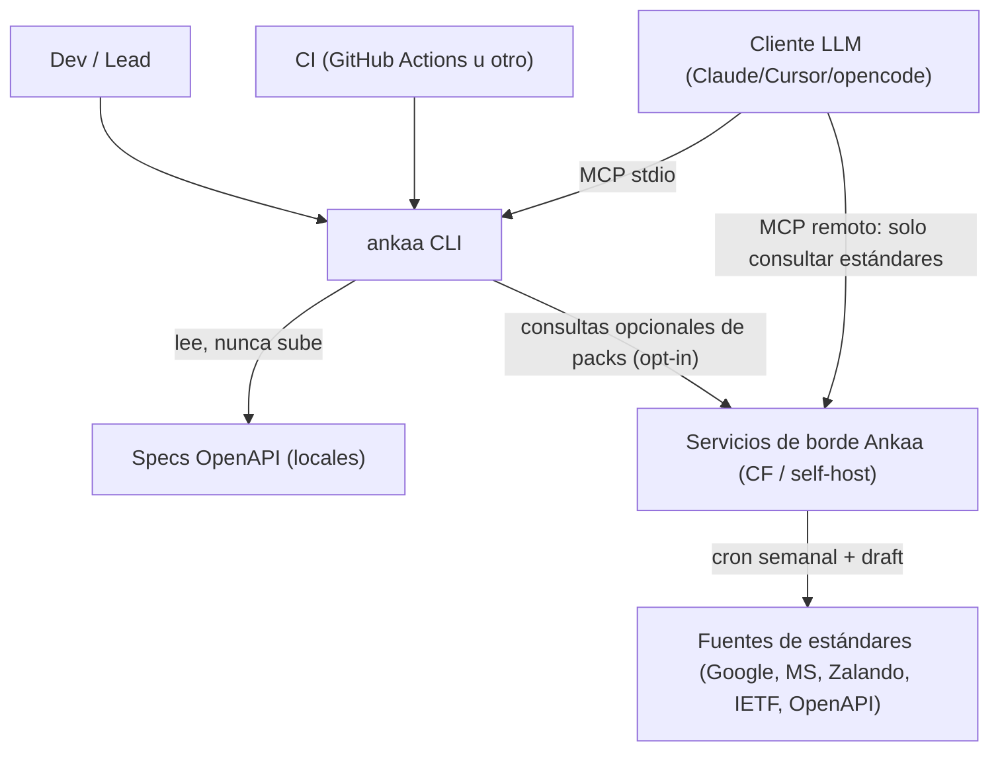
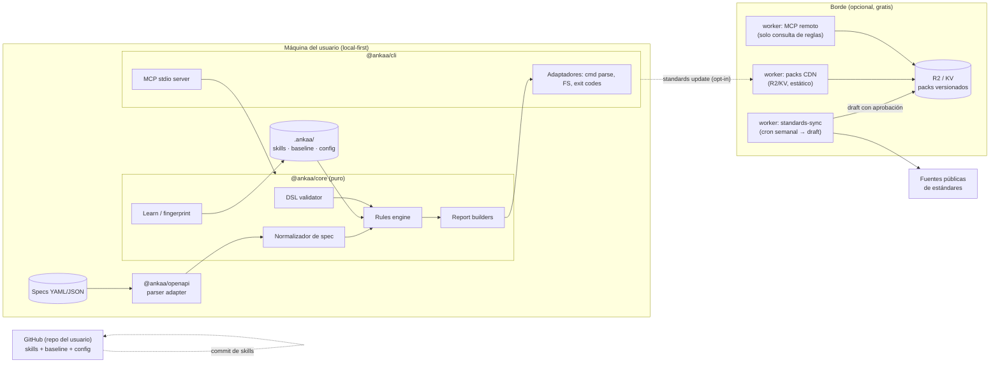
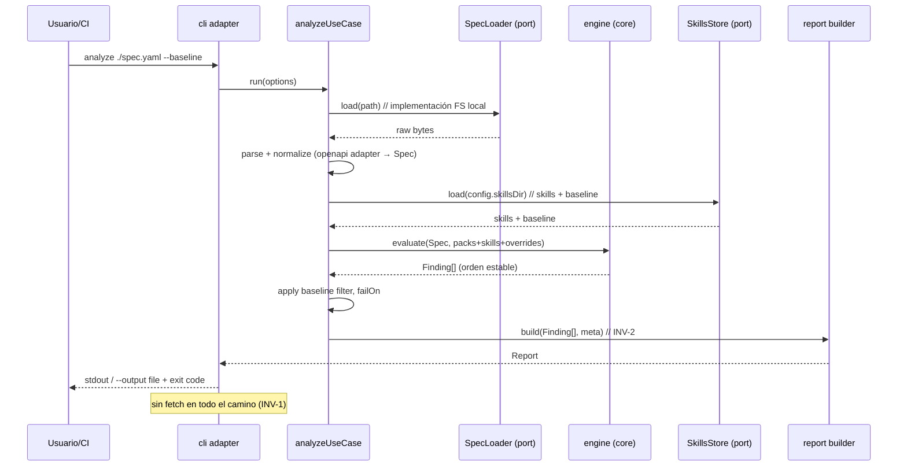
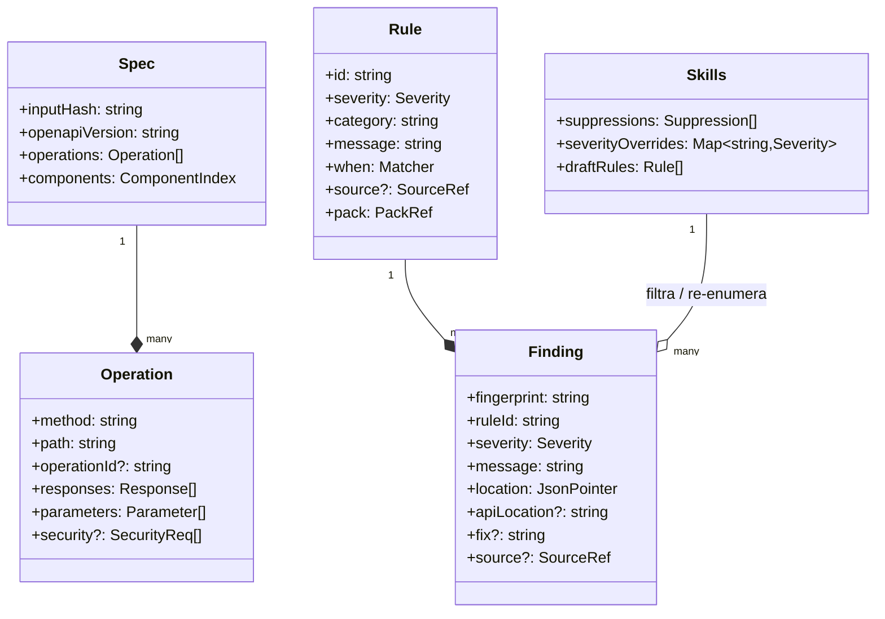

# 02 · Arquitectura

Ankaa · SDD · v1.0

---

## 1. Principios de diseño

| #   | Principio                           | Traducción práctica                                                                                                       |
| --- | ----------------------------------- | ------------------------------------------------------------------------------------------------------------------------- |
| P1  | **Core puro, adaptadores al borde** | El motor no importa `fs`, `fetch`, `process` ni `@modelcontextprotocol/*`; los adaptadores (CLI, MCP, tests) inyectan I/O |
| P2  | **Specs son datos, no código**      | DSL declarativa con whitelist; `eval` prohibido; findings sobre un modelo normalizado, no sobre strings crudos            |
| P3  | **Determinismo antes que atajo**    | Sin random, sin orden de hash no estables, sin "fecha" dentro del hash de findings                                        |
| P4  | **Cita o no existe**                | Toda regla elite tiene `source`; el `explain` muestra de dónde salió                                                      |
| P5  | **Privacidad por arquitectura**     | No hay client HTTP en el path de análisis — es más fácil probar que no hay red que prometer que no la usamos              |
| P6  | **Aprendizaje = git diff**          | Skills son archivos de texto; si no es mergeable, no es aprendizaje                                                       |
| P7  | **Caro solo donde aporta**          | LLM, cloud y dashboards fuera del critical path; el core vive sin ellos                                                   |

## 2. Contexto (C4 nivel 1)



Nota: la flecha CLI → AS es de **lectura local**. No existe arco AS → SRV.

## 3. Contenedores (C4 nivel 2)



## 4. Clean Architecture (capas)

```
┌─────────────────────────────────────────────────────────┐
│  Adapters (impuros, inyectan I/O)                      │
│  ├── cli/          parseo de argv, FS, colores, exit    │
│  ├── mcp/          stdio + tools schema                │
│  ├── worker/       CF: cron, R2, KV, HTTP              │
│  └── testing/      fixtures, red fail-fast             │
├─────────────────────────────────────────────────────────┤
│  Application (casos de uso, orquestación pura)         │
│  ├── analyzeUseCase    load → normalize → run → report │
│  ├── learnUseCase      report+feedback → skills patch  │
│  ├── initUseCase       scaffold .ankaa/           │
│  └── rulesQuery        list / explain                  │
├─────────────────────────────────────────────────────────┤
│  Domain / Core (sin I/O, sin CF, sin MCP)              │
│  ├── model: Spec (normalizado), Finding, Severity      │
│  ├── engine: matchers, evaluación, orden estable       │
│  ├── rules: Rule schema, pack types                    │
│  ├── dsl: validación declarativa whitelist             │
│  ├── fingerprint / baseline / skills merge             │
│  └── report: JSON estable + render console             │
├─────────────────────────────────────────────────────────┤
│  Ports (interfaces del dominio)                        │
│  ├── SpecLoader, PackRepository, SkillsStore,          │
│  │   Clock (solo metadata, no en hash), Logger         │
└─────────────────────────────────────────────────────────┘
```

Reglas de dependencia (verificadas con lint `import/no-restricted-paths`):

- `core` → nada de adapters; no `node:fs`, no `fetch`, no `path` (usa paths como strings normalizados).
- `application` → `core` + ports; no implementa ports.
- adapters → `application` + implementan ports.

### 5. Flujo de `analyze` (secuencia)



### 6. Monorepo (pnpm workspaces)

```
Ankaa/
├── packages/
│   ├── core/            # domain + engine + dsl + learn (sin I/O)
│   ├── openapi/         # parseo/normalización OpenAPI → Spec
│   ├── reporters/       # console, json, sarif, markdown, annotations
│   ├── cli/             # bin ankaa + MCP stdio embebido
│   └── mcp/             # definición de tools compartida cli/worker
├── packs/
│   └── elite/           # rule packs YAML versionados (fuente de verdad)
├── worker/              # Cloudflare Worker + cron de fuentes
├── fixtures/            # specs OpenAPI de prueba (+ malformados)
├── docs/                # este SDD
├── specs/ plans/ tasks/ # documentación spec-driven (fase siguiente)
└── docker/              # Dockerfile + compose self-host
```

Empieza con 6 packages; extraer más solo si hay un segundo consumidor real (riesgo S9).

## 7. ADRs

### ADR-001: TypeScript, no Go ni Python

**Contexto:** motor + CLI + MCP + Worker en CF.  
**Decisión:** TypeScript (ESM), Node ≥ 22, strict.
**Consecuencias:** MCP SDK y Workers 1st-class; `npx` como distribución; descartamos binario Go (duplicaría lógica o requeriría bindings) y Python (mal encaje con CF Workers). Trade-off: performance < Go en parseo gigante — aceptable con NFR-02 (≤ 1 MB).  
**Estado:** aceptada.

### ADR-002: OpenAPI-first, antes que code-first

**Contexto:** extraer APIs de código requiere parsers por framework y cubre mal specs desactualizadas.  
**Decisión:** v0 analiza OpenAPI/Swagger; código/proto/graphql son adapters posteriores.  
**Consecuencias:** MVP rápido y valor claro (el spec es el contrato); equipos sin spec reciben onboarding, no inventamos código fantasma.  
**Estado:** aceptada.

### ADR-003: Local-first, análisis nunca sale de la máquina

**Contexto:** requisito de privacidad + CF free no da CPU para parseo (10 ms/req).  
**Decisión:** todo `analyze` offline; servicios de borde solo distribuyen/consultan metadata de estándares.  
**Consecuencias:** no hay "honest dashboard" hosted en v1; SIEM/gate = CI del usuario con reportes locales. Diferencial de venta vs SaaS que sube specs.  
**Estado:** aceptada.

### ADR-004: Clean Architecture hexagonal

**Contexto:** mismo core para CLI, tests, MCP y futuro worker de análisis self-host.  
**Decisión:** puertos y adaptadores; core sin I/O.  
**Consecuencias:** tests rápidos sin mocks de red; riesgo de boilerplate — mitigado manteniendo puertos mínimos (4–5).  
**Estado:** aceptada.

### ADR-005: Motor determinista; LLM solo opcional y fuera del core

**Contexto:** "0 tokens" como diferencial; governance es mayormente estructural.  
**Decisión:** reglas = patrones/AST sobre modelo normalizado. Si algún día hay modo `--llm-hints` para textos subjetivos, vive como paquete aparte, opt-in, nunca en `core` ni en CI default.  
**Consecuencias:** some "smell" subjetivo queda para review humana; costo marginal de análisis ≈ 0.  
**Estado:** aceptada.

### ADR-006: Rule packs versionados con fuente citada

**Contexto:** estándares cambian; CI necesita estabilidad.  
**Decisión:** packs YAML con `version` inmutable (calver tipo `2026.09.1`), cada regla con `source`; pin en config; worker propone drafts.  
**Consecuencias:** upgrades explícitos + changelog; sin "regla fantasma" nueva en un lunes sin aviso.  
**Estado:** aceptada.

### ADR-007: Skills en git, no modelo entrenado

**Contexto:** "motor que se retroalimente" sin costo de inferencia.  
**Decisión:** feedback → suppressions/severities/drafts como archivos en `.ankaa/skills/`, mergeables, idempotentes (INV-5).  
**Consecuencias:** el aprendizaje es auditable y viaja con el repo; no mejora "solito" — mejora donde el equipo committea.  
**Estado:** aceptada.

### ADR-008: Cloudflare para servicios de borde, no para análisis

**Contexto:** queremos distribución global gratis + MCP remoto + cron.  
**Decisión:** Workers (packs estáticos + MCP consulta + standards-sync); R2/KV para artifacts. Análisis de specs del usuario jamás corre en CF.  
**Consecuencias:** se respeta INV-1/INV-3; free tier suficiente (ver 05). Self-host alternativo con compose (ADR-010).  
**Estado:** aceptada.

### ADR-009: MCP stdio local como interfaz IA primaria

**Contexto:** los clientes LLM abren el repo local; los tools deben ver el filesystem del usuario.  
**Decisión:** `ankaa mcp` (stdio) con tools completos de análisis; MCP remoto CF solo `list_packs`/`explain_rule`/`get_pack`.  
**Consecuencias:** UX "agente que analiza mi repo" sin subir nada; remoto no puede (y no debe) analizar specs ajenos.  
**Estado:** aceptada.

### ADR-010: Docker Compose para dev y self-host

**Contexto:** equipos sin CF, paridad CI, prueba del stack de borde.  
**Decisión:** compose con servicios de borde emulados (registry estático de packs, worker simulado o wrangler dev) + imágenes oficiales para CLI en CI containers.  
**Consecuencias:** el CLI **no** requiere Docker; compose es opcional.  
**Estado:** aceptada.

### ADR-011: Determinismo e idempotencia como invariantes

**Contexto:** CI y learn deben ser reproducibles.  
**Decisión:** orden estable de findings; `inputHash` del spec; fingerprints de findings; `learn` merge idempotente; timestamps solo en metadatos fuera del hash.  
**Consecuencias:** diffs de reporte significativos; upgrades de pack cambian findings de forma reviewable.  
**Estado:** aceptada.

### ADR-012: Monorepo pnpm workspaces

**Contexto:** core compartido por CLI/MCP/worker/reporters.  
**Decisión:** pnpm + workspaces + changesets para versionar.  
**Consecuencias:** atomidad de cambios cross-package; releases independientes cuando haga falta.  
**Estado:** aceptada.

### ADR-013: Visor local de reportes (no es un portal)

**Contexto:** los reportes JSON son ricos pero ilegibles; pedir un dashboard choca con el anti-alcance "no es un portal" del SDD §4.  
**Decisión:** un script Node cross-OS (`ankaa dashboard <reporte.json>`) levanta un visor **estático en loopback** (127.0.0.1, sin auth multi-usuario, sin estado remoto). Lee JSON explícitos; el tracking vive en un sidecar local junto al reporte. `analyze` no lo conoce ni lo necesita. Si el usuario hospeda el visor o conecta el JSON a Jira/ServiceNow/Slack, es su red, sus credenciales y su riesgo — nosotros entregamos el JSON con contrato estable, no las integraciones.  
**Consecuencias:** SDD §4 enmendado con la excepción explícita; el dashboard no ejecuta análisis ni toca el core. El workspace posterior se rige por ADR-015; INV-1/INV-7 siguen aplicando.  
**Estado:** aceptada.

### ADR-015: Workspace guiado local con operaciones allowlistadas

**Contexto:** el CLI ofrece capacidades útiles pero exige conocer comandos y opciones; el visor F10 solo lee reportes, mientras que el usuario necesita iniciar análisis, entender progreso, retomar batches y consultar/comparar resultados anteriores. Un portal remoto contradiría local-first y agregaría estado/credenciales.

**Decisión:**

1. Evolucionar el proceso CLI local con dos adapters guiados —terminal y web loopback— que llaman casos de uso tipados compartidos. El dashboard anterior sigue soportado.
2. La UI puede iniciar solo operaciones explícitamente allowlistadas; no expone shell arbitraria ni endpoints genéricos de filesystem. Bind a `127.0.0.1`, puerto efímero por defecto, validación Host/Origin y token aleatorio en memoria para mutaciones.
3. Persistir historial/checkpoints únicamente bajo `.ankaa/workspace/` o una ubicación alternativa elegida expresamente. No guardar credentials; conservar ejecuciones previas.
4. Una ejecución “desde cero” analiza todos los repos en un nuevo run. “Continuar” retoma un run o reutiliza resultados solo cuando identidad de fuente, revisión y huella efectiva de análisis (versión/configuración/packs) se verifican. Si no, se reanaliza o se reporta error explícito.
5. Las acciones de red (p. ej. consultar/clonar GitHub) son visibles y elegidas por el usuario; el análisis sigue local. La preparación de CI previsualiza y requiere confirmación antes de escribir; no activa controles del proveedor.

**Consecuencias:** se amplía ADR-013 sin convertir el producto en portal: el servidor local ahora orquesta acciones conocidas y expone progreso/resultados locales. La superficie de red queda en adapters CLI; core y engine continúan puros. Host/Origin/token, rutas allowlistadas, escritura atómica, escape de contenido e INV-1/2/3/4/7 son gates de aceptación. La lectura de paths requiere selección/entrada explícita del usuario y la escritura requiere preview/confirmación.  
**Estado:** aceptada para implementación mediante `f15-local-workspace`.

### ADR-014: Spectral se importa (transpila), no se ejecuta

**Contexto:** Spectral (Stoplight) trae miles de reglas community en rulesets con otro DSL: `given` (JSONPath) + `then` (funciones: `truthy`, `pattern`, `alphabetical`, `schema`, custom JS `oas*`). Heredarlas suena gratis, pero es un segundo DSL con expresiones arbitrarias. Spike M8.6 (2026-09-30) auditó el ruleset OAS real (~50 reglas) contra nuestros ~70 átomos.

**Decisión:**

1. **Rechazado: motor JSONPath/funciones en runtime** (core o adapter). Violaría INV-4 (expresiones arbitrarias vs whitelist), P2 (specs son datos) y P7 (peso del bundle por reglas que pocos usan); las funciones custom JS son código arbitrario y no entran jamás.
2. **Aceptado: transpilador determinista offline** como modo de `rules import` (reusa pipeline M8.2: envelope + `validateRule` + reporte de skips). Solo el subconjunto mapeable (~20 reglas); lo demás se saltea con motivo, nunca en silencio. Sin análisis, sin red, sin LLM: parse JSON → YAML drafts.
3. **Aceptado: port curado a elite** como épica aparte (las joyas no cubiertas, con fuente y medición de ruido del playbook f8).

**Mapeo del spike (ruleset OAS real → elite):**

Cubiertas hoy (14): `operation-success-response`→RESP-001, `operation-operationId(-unique)`→NAMING-003, `operation-parameters`→PARAM-006, `operation-tag-defined`→STRUCT-005, `path-params`→NAMING-009/PARAM-001/002, `path-keys-no-trailing-slash`→NAMING-002, `path-not-include-query`→NAMING-011, `oas3-operation-security-defined`→AUTH-003, `oas3-unused-component`→STRUCT-008 (parcial: solo schemas), `oas3-api-servers`→STRUCT-004, `info-description`→DOCS-005, `operation-description`→DOCS-002, `operation-tags`→DOCS-003.

Mapeables con átomos existentes (port directo): `path-declarations-must-exist`→`pathMatches \{\}`, `no-eval-in-markdown`+`no-script-tags-in-markdown`→`not descriptionMatches`, `operation-operationId-valid-in-url`→`operationIdPattern` (solo custom: colisiona con NAMING-004 como default).

Port curado (átomos nuevos chicos): `oas3-server-not-example.com`+`oas3-server-trailing-slash`→átomo `serverUrlMatches`; `info-contact`+`info-license`+`license-url`→extender `DocField`; `duplicated-entry-in-enum`→átomo `duplicateEnumValues`; `array-items`→átomo `arrayItemsMissing`; `no-$ref-siblings`→átomo `refWithSiblings` (el modelo preserva siblings); `openapi-tags-uniqueness`→átomo `duplicateTagNames` (marginal); `oas3-server-variables`→átomo dedicado (moderado); `tag-description`→parser (descripciones de tags raíz) + átomo (mayor).

Solo-transpilable como custom (política débil, no default elite): `operation-singular-tag` (`length`), `openapi-tags-alphabetical` (`alphabetical`).

Fuera de alcance honesto (necesitan validadores/JS): `typed-enum`, `oas3-valid-media/schema-example` y familia `oas2-valid-*` (validación JSON Schema completa), `oas3-examples-value-or-externalValue` (forma xor de Example Object), reglas `oas2-*` (Swagger 2.0 se convierte, no se gobierna) y `oas3_1-*` de webhooks/callbacks (marginales).

**Consecuencias:** cero cambios en runtime de core; el import vive en el adapter CLI; `strictSource` se satisface citando la regla Spectral origen (título+URL del ruleset); el criterio de entrada de M8.6 queda cumplido con este ADR.
**Estado:** aceptada (spike). Implementación pendiente de spec `f8-spectral-import` (transpilador) y épica de port curado.

## 8. Modelo de dominio mínimo (glifo)



## 9. Decisiones explícitas pendientes (backlog de ADRs)

| Tema                      | Opciones                                                        | Cuando decidir                                                                                        |
| ------------------------- | --------------------------------------------------------------- | ----------------------------------------------------------------------------------------------------- |
| Validador OpenAPI         | `@apidevtools/swagger-parser` vs validador propio + JSON Schema | Fase 1 (implícito en ADR-002)                                                                         |
| Motor de matchers         | JSONPath-like propio vs CEL-lite vs zod-predicates declarativos | Fase 1–2 (detalle en 03)                                                                              |
| Canal de updates de packs | solo `pin manual` vs `stable` auto en minor                     | Fase 6                                                                                                |
| Lenguaje de UI findings   | EN only vs EN+ES                                                | Fase 5 → **decidido en f5: EN only** (mensajes de findings en inglés, consumer CI global — AGENTS §4) |

---

_Continuar: [03-motor-y-reglas.md](03-motor-y-reglas.md)._
