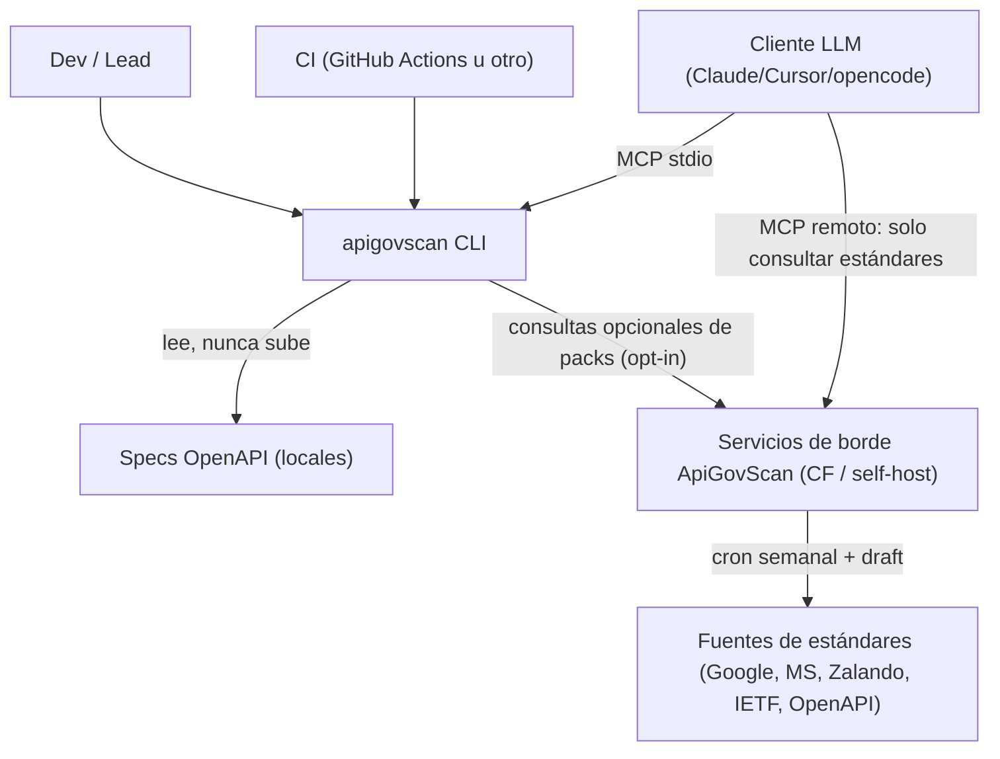
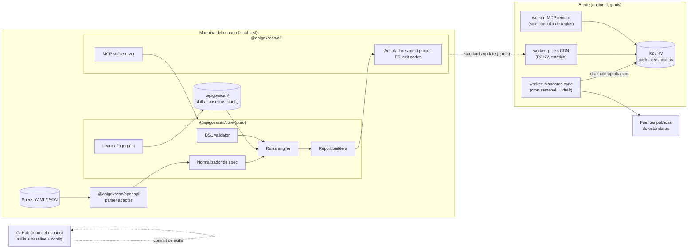
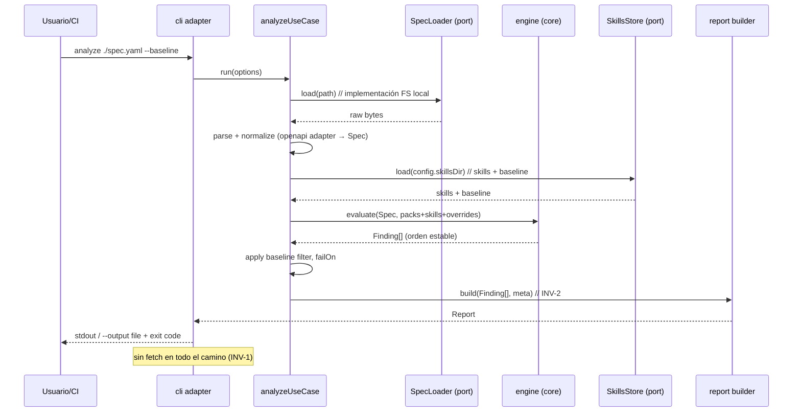
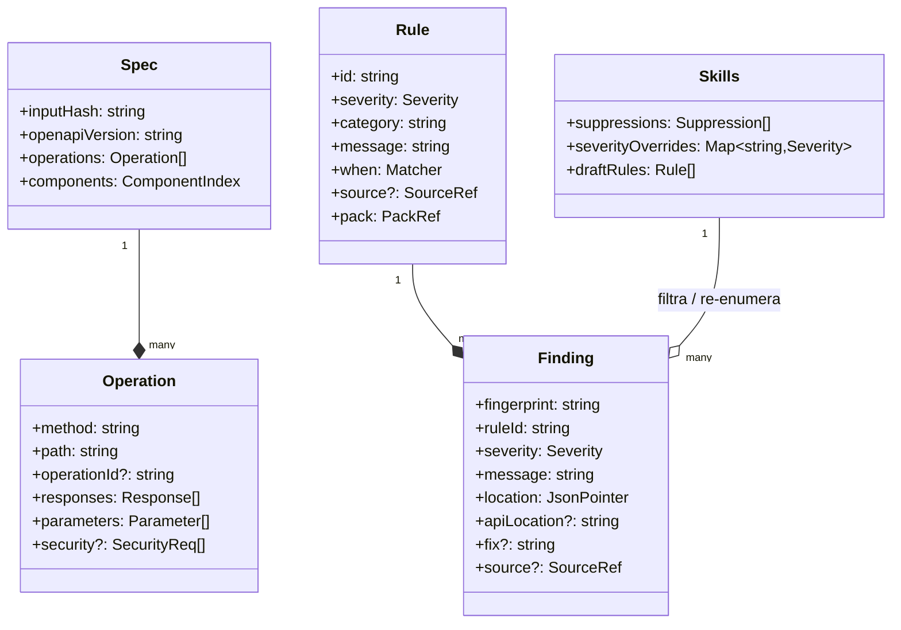

# 02 · Arquitectura

ApiGovScan · SDD · v1.0

---

## 1. Principios de diseño

| # | Principio | Traducción práctica |
|---|---|---|
| P1 | **Core puro, adaptadores al borde** | El motor no importa `fs`, `fetch`, `process` ni `@modelcontextprotocol/*`; los adaptadores (CLI, MCP, tests) inyectan I/O |
| P2 | **Specs son datos, no código** | DSL declarativa con whitelist; `eval` prohibido; findings sobre un modelo normalizado, no sobre strings crudos |
| P3 | **Determinismo antes que atajo** | Sin random, sin orden de hash no estables, sin "fecha" dentro del hash de findings |
| P4 | **Cita o no existe** | Toda regla elite tiene `source`; el `explain` muestra de dónde salió |
| P5 | **Privacidad por arquitectura** | No hay client HTTP en el path de análisis — es más fácil probar que no hay red que prometer que no la usamos |
| P6 | **Aprendizaje = git diff** | Skills son archivos de texto; si no es mergeable, no es aprendizaje |
| P7 | **Caro solo donde aporta** | LLM, cloud y dashboards fuera del critical path; el core vive sin ellos |

## 2. Contexto (C4 nivel 1)



Nota: la flecha CLI → AS es de **lectura local**. No existe arco AS → SRV.

## 3. Contenedores (C4 nivel 2)



## 4. Clean Architecture (capas)

```
┌─────────────────────────────────────────────────────────┐
│  Adapters (impuros, inyectan I/O)                      │
│  ├── cli/          parseo de argv, FS, colores, exit    │
│  ├── mcp/          stdio + tools schema                │
│  ├── worker/       CF: cron, R2, KV, HTTP              │
│  └── testing/      fixtures, red fail-fast             │
├─────────────────────────────────────────────────────────┤
│  Application (casos de uso, orquestación pura)         │
│  ├── analyzeUseCase    load → normalize → run → report │
│  ├── learnUseCase      report+feedback → skills patch  │
│  ├── initUseCase       scaffold .apigovscan/           │
│  └── rulesQuery        list / explain                  │
├─────────────────────────────────────────────────────────┤
│  Domain / Core (sin I/O, sin CF, sin MCP)              │
│  ├── model: Spec (normalizado), Finding, Severity      │
│  ├── engine: matchers, evaluación, orden estable       │
│  ├── rules: Rule schema, pack types                    │
│  ├── dsl: validación declarativa whitelist             │
│  ├── fingerprint / baseline / skills merge             │
│  └── report: JSON estable + render console             │
├─────────────────────────────────────────────────────────┤
│  Ports (interfaces del dominio)                        │
│  ├── SpecLoader, PackRepository, SkillsStore,          │
│  │   Clock (solo metadata, no en hash), Logger         │
└─────────────────────────────────────────────────────────┘
```

Reglas de dependencia (verificadas con lint `import/no-restricted-paths`):

- `core` → nada de adapters; no `node:fs`, no `fetch`, no `path` (usa paths como strings normalizados).
- `application` → `core` + ports; no implementa ports.
- adapters → `application` + implementan ports.

### 5. Flujo de `analyze` (secuencia)



### 6. Monorepo (pnpm workspaces)

```
ApiGovScan/
├── packages/
│   ├── core/            # domain + engine + dsl + learn (sin I/O)
│   ├── openapi/         # parseo/normalización OpenAPI → Spec
│   ├── reporters/       # console, json, sarif, markdown, annotations
│   ├── cli/             # bin apigovscan + MCP stdio embebido
│   └── mcp/             # definición de tools compartida cli/worker
├── packs/
│   └── elite/           # rule packs YAML versionados (fuente de verdad)
├── worker/              # Cloudflare Worker + cron de fuentes
├── fixtures/            # specs OpenAPI de prueba (+ malformados)
├── docs/                # este SDD
├── specs/ plans/ tasks/ # documentación spec-driven (fase siguiente)
└── docker/              # Dockerfile + compose self-host
```

Empieza con 6 packages; extraer más solo si hay un segundo consumidor real (riesgo S9).

## 7. ADRs

### ADR-001: TypeScript, no Go ni Python

**Contexto:** motor + CLI + MCP + Worker en CF.  
**Decisión:** TypeScript (ESM), Node ≥ 20, strict.  
**Consecuencias:** MCP SDK y Workers 1st-class; `npx` como distribución; descartamos binario Go (duplicaría lógica o requeriría bindings) y Python (mal encaje con CF Workers). Trade-off: performance < Go en parseo gigante — aceptable con NFR-02 (≤ 1 MB).  
**Estado:** aceptada.

### ADR-002: OpenAPI-first, antes que code-first

**Contexto:** extraer APIs de código requiere parsers por framework y cubre mal specs desactualizadas.  
**Decisión:** v0 analiza OpenAPI/Swagger; código/proto/graphql son adapters posteriores.  
**Consecuencias:** MVP rápido y valor claro (el spec es el contrato); equipos sin spec reciben onboarding, no inventamos código fantasma.  
**Estado:** aceptada.

### ADR-003: Local-first, análisis nunca sale de la máquina

**Contexto:** requisito de privacidad + CF free no da CPU para parseo (10 ms/req).  
**Decisión:** todo `analyze` offline; servicios de borde solo distribuyen/consultan metadata de estándares.  
**Consecuencias:** no hay "honest dashboard" hosted en v1; SIEM/gate = CI del usuario con reportes locales. Diferencial de venta vs SaaS que sube specs.  
**Estado:** aceptada.

### ADR-004: Clean Architecture hexagonal

**Contexto:** mismo core para CLI, tests, MCP y futuro worker de análisis self-host.  
**Decisión:** puertos y adaptadores; core sin I/O.  
**Consecuencias:** tests rápidos sin mocks de red; riesgo de boilerplate — mitigado manteniendo puertos mínimos (4–5).  
**Estado:** aceptada.

### ADR-005: Motor determinista; LLM solo opcional y fuera del core

**Contexto:** "0 tokens" como diferencial; governance es mayormente estructural.  
**Decisión:** reglas = patrones/AST sobre modelo normalizado. Si algún día hay modo `--llm-hints` para textos subjetivos, vive como paquete aparte, opt-in, nunca en `core` ni en CI default.  
**Consecuencias:** some "smell" subjetivo queda para review humana; costo marginal de análisis ≈ 0.  
**Estado:** aceptada.

### ADR-006: Rule packs versionados con fuente citada

**Contexto:** estándares cambian; CI necesita estabilidad.  
**Decisión:** packs YAML con `version` inmutable (calver tipo `2026.09.1`), cada regla con `source`; pin en config; worker propone drafts.  
**Consecuencias:** upgrades explícitos + changelog; sin "regla fantasma" nueva en un lunes sin aviso.  
**Estado:** aceptada.

### ADR-007: Skills en git, no modelo entrenado

**Contexto:** "motor que se retroalimente" sin costo de inferencia.  
**Decisión:** feedback → suppressions/severities/drafts como archivos en `.apigovscan/skills/`, mergeables, idempotentes (INV-5).  
**Consecuencias:** el aprendizaje es auditable y viaja con el repo; no mejora "solito" — mejora donde el equipo committea.  
**Estado:** aceptada.

### ADR-008: Cloudflare para servicios de borde, no para análisis

**Contexto:** queremos distribución global gratis + MCP remoto + cron.  
**Decisión:** Workers (packs estáticos + MCP consulta + standards-sync); R2/KV para artifacts. Análisis de specs del usuario jamás corre en CF.  
**Consecuencias:** se respeta INV-1/INV-3; free tier suficiente (ver 05). Self-host alternativo con compose (ADR-010).  
**Estado:** aceptada.

### ADR-009: MCP stdio local como interfaz IA primaria

**Contexto:** los clientes LLM abren el repo local; los tools deben ver el filesystem del usuario.  
**Decisión:** `apigovscan mcp` (stdio) con tools completos de análisis; MCP remoto CF solo `list_packs`/`explain_rule`/`get_pack`.  
**Consecuencias:** UX "agente que analiza mi repo" sin subir nada; remoto no puede (y no debe) analizar specs ajenos.  
**Estado:** aceptada.

### ADR-010: Docker Compose para dev y self-host

**Contexto:** equipos sin CF, paridad CI, prueba del stack de borde.  
**Decisión:** compose con servicios de borde emulados (registry estático de packs, worker simulado o wrangler dev) + imágenes oficiales para CLI en CI containers.  
**Consecuencias:** el CLI **no** requiere Docker; compose es opcional.  
**Estado:** aceptada.

### ADR-011: Determinismo e idempotencia como invariantes

**Contexto:** CI y learn deben ser reproducibles.  
**Decisión:** orden estable de findings; `inputHash` del spec; fingerprints de findings; `learn` merge idempotente; timestamps solo en metadatos fuera del hash.  
**Consecuencias:** diffs de reporte significativos; upgrades de pack cambian findings de forma reviewable.  
**Estado:** aceptada.

### ADR-012: Monorepo pnpm workspaces

**Contexto:** core compartido por CLI/MCP/worker/reporters.  
**Decisión:** pnpm + workspaces + changesets para versionar.  
**Consecuencias:** atomidad de cambios cross-package; releases independientes cuando haga falta.  
**Estado:** aceptada.

## 8. Modelo de dominio mínimo (glifo)



## 9. Decisiones explícitas pendientes (backlog de ADRs)

| Tema | Opciones | Cuando decidir |
|---|---|---|
| Validador OpenAPI | `@apidevtools/swagger-parser` vs validador propio + JSON Schema | Fase 1 (implícito en ADR-002) |
| Motor de matchers | JSONPath-like propio vs CEL-lite vs zod-predicates declarativos | Fase 1–2 (detalle en 03) |
| Canal de updates de packs | solo `pin manual` vs `stable` auto en minor | Fase 6 |
| Lenguaje de UI findings | EN only vs EN+ES | Fase 5 → **decidido en f5: EN only** (mensajes de findings en inglés, consumer CI global — AGENTS §4) |

---

*Continuar: [03-motor-y-reglas.md](03-motor-y-reglas.md).*
