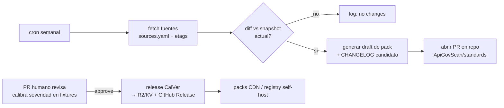

# 04 · Estándares

ApiGovScan · SDD · v1.0

---

## 1. Principio

Nosotros no inventamos la excelencia de API: **la curamos, la versionamos y la citamos**. El pack `elite` es una síntesis auditable de guías públicas de alto prestigio. Cada regla elite trae `source`; si no se puede citar, no entra al pack.

## 2. Fuentes primarias curadas (pack `elite`)

| Fuente | Qué aporta al pack | Cadencia de cambio percibida | Repo/URL canónico |
|---|---|---|---|
| **Google API Design Guide** | Naming de recursos, pluralización, operaciones, estándar de filtros/paginación | Baja (documento estable) | `googleapis/googleapis` / API design guide público |
| **Microsoft REST API Guidelines** | URIs, versionado, filtros, errores, deprecación, long-running ops | Media (evoluciona en repo) | `microsoft/api-guidelines` (Azure REST Guidelines) |
| **Zalando RESTful API Guidelines** | Consistencia, HTTP headers, errores HTTP problem+json, paginación, compatibilidad | Media | `zalando/restful-api-guidelines` |
| **IETF RFCs (HTTP/API)** | RFC 9110 (HTTP semantics), 9112, 5789? (no), 6585, 7807/9457 (problem details), 8594? (Sunset — actually RFC 8594 is Sunset), 5988/8288 (Web Linking), 8941 (Field Values), 6570 (URI Templates), 9111 (HTTP caching) | Baja–media (RFCs nuevos poco frecuentes) | `ietf.org` datatracker |
| **OpenAPI Specification** | Validez estructural del spec, extensiones `x-*`, security schemes | Media | `OAI/OpenAPI-Specification` |
| **APIs.guru / directory practices** | Señales de prácticas comunes en specs reales (uso de operationId, examples) | Baja | `apis-guru` |
| **Swagger (SmartBear) API Design Guide** | Complemento práctico de naming y estructura OpenAPI | Baja | docs de SmartBear / Swagger |

> Las URLs exactas y secciones se fijan en `packs/elite/<version>/sources.yaml` como snapshot citable; el worker (§6) detecta cambios upstream.

### Fuentes secundarias (candidatas a / v2 del pack)

- Salesforce API Guidelines, Shopify API design primer, GitLab API guidelines, AWS API style (donde sea público y license-compatible).
- RFCs de operación: rate limit headers (`draft-ietf-httpapi-ratelimit-headers`), Idempotency-Key (prácticas Stripe/IBM open).

**Criterio de inclusión de fuente:**

1. Pública y citable con URL estable.
2. Licencia permite resumir/interpretar con cita (no copiar textos largos verbatim sin atribución).
3. Aplica a HTTP/JSON APIs (core de ApiGovScan).
4. Un humano del equipo puede mapearla a reglas ejecutables (no solo prosa).

## 3. De fuente a regla (proceso de curación)

```
1. Lectura de la guía (humano + revisión asistida)
2. Candidatas a reglas: ¿es ejecutable sobre OpenAPI? ¿es unívoca?
3. Draft en PR: id, severity, message EN, when, source con section
4. Revisión: falsos positivos potentes en 3+ fixtures públicos
5. Release minor/major del pack con changelog
6. Canario → stable (§7)
```

**Regla de severidad default (guía de calibración):**

| Evidencia | Severity |
|---|---|
| Rompe compatibilidad / seguridad / validez del spec | `error` |
| Dolor de integración demostrable (errores no documentados, sin operationId en tooling) | `warning` |
| Estilo / preferencia de la guía sin dolor medible | `info` |

Las guías suelen ser prosa fuerte; **no** traducimos "SHALL" de un RFC en `error` sin contexto de OpenAPI — primero medimos ruido en fixtures.

## 4. Taxonomía y naming de reglas elite

```
<CATEGORY>-<NNN>
```

| Prefijo | Dominio | Ejemplo |
|---|---|---|
| `STRUCT-` | Estructura del spec (openapi, info, servers) | `STRUCT-001` versión openapi presente |
| `NAMING-` | Paths, campos, operationId, headers | `NAMING-001` paths plurales |
| `DOCS-` | summary, description, examples, tags | `DOCS-001` summary mínimo |
| `PARAM-` | Parameters, query, path, headers | `PARAM-003` naming query camelCase |
| `SCHEMA-` | Models, components, reuse | `SCHEMA-002` evitar inline object profundo sin ref |
| `RESP-` | Responses, status codes | `RESP-001` 2xx documentado |
| `ERR-` | Errores, problem+json, 4xx/5xx | `ERR-010` write con 4xx |
| `AUTH-` | securitySchemes, operaciones públicas | `AUTH-001` security global o por op |
| `PAG-` | Paginación y colecciones | `PAG-001` GET collection con estilo page/cursor |
| `VER-` | Versionado, servers, deprecation | `VER-001` estilo de versionado consistente |
| `DEPR-` | Deprecación y sunset | `DEPR-002` deprecated sin sunset |
| `CONS-` | Consistencia transversal (mayúsculas, enums) | `CONS-004` casing consistente en enums |
| `SEC-` | Datos sensibles en examples, TLS servers | `SEC-003` ejemplos sin secretos |
| `PERF-` | Hints (select, $ref depth) | `PERF-001` advertir spec > tamaño razonable |

Los ids **no se reasignan** tras release (deprecación explícita con `deprecated: true` en el changelog del pack).

## 5. Versionado de packs

- Formato de versión: **CalVer** `YYYY.MM.PATCH` (ej. `2026.09.1`).
- Inmutable: un version publicado jamás se edita; correcciones = nuevo PATCH.
- **Major implícito en año/mes** — breaking changes de significado de regla suben `YYYY.MM` y exigen changelog "BREAKING".
- Config del usuario:

```yaml
# apigovscan.yaml
standards:
  pack: elite
  version: "2026.09.1"    # pin recomendado en CI
  # channel: stable       # alternativa a pin (no recommended en CI)
```

- Reporte siempre lleva `packs[].version` (INV-6).

### Canales

| Canal | Contenido | Uso |
|---|---|---|
| `stable` | Último release aprobado | Default humana local |
| `canary` | Siguiente draft aprobado para prueba | Guilds que quieren anticipar |
| pinned | Versión exacta | **CI / producción** |

## 6. Worker de actualización (Cloudflare Cron)

### Propósito

Detectar cambios en fuentes y **proponer** actualizaciones — nunca auto-mergear silenciosamente reglas nuevas a `stable`.

### Cadencia

- **Cron semanal** (lunes 06:00 UTC): barato, suficiente (los estándares no cambian a diario).
- El job **no publica** si no hay diff; no genera churn.

### Pipeline del worker



### Mecanismos de detección

| Fuente | Mecanismo |
|---|---|
| GitHub (`microsoft/api-guidelines`, `zalando/...`, `OAI/...`) | API / atom feed de tags + `paths` de archivos watcheados; `If-None-Match` ETag |
| RFCs | Datatracker API de últimos RFCs en áreas HTTP/HTTPAPI |
| Google guide | Snapshot del documento watcheado (hash) |
| APIs.guru | Feed de cambios del directory (señal secundaria) |

### Salidas del draft

1. **Branch/PR** en el repo de estándares: diff de `packs/elite/<nueva>/rules/**` + `CHANGELOG.md`.
2. **Informe de impacto:** con fixtures del repo, ¿cuántos findings nuevos por severidad? (ruido gate).
3. Tras aprobación humana: publicación CalVer + assets a **R2** (+ metadata en **KV**) y mirror en Git tags.

### Por qué no auto-merge

- Un cambio de guía mal traducido a matcher rompe CI de todos los usuarios en un lunes.
- El producto promete **estabilidad pinneable**; la frescura se maneja con `canary` + changelog, no con mutación silenciosa.

### Interfaces del worker

| Ruta / tool | Auth | Descripción |
|---|---|---|
| `GET /packs` | pública | lista versions |
| `GET /packs/:id/:version` | pública | bundle YAML/JSON (cache largo, inmutable) |
| `GET /packs/:id/stable.json` | pública | manifiesto del canal stable |
| `POST /admin/sync` (o solo cron) | token | fuerza sync |
| MCP remoto: `list_packs`, `explain_rule`, `get_pack` | opcional (API key o Access) | solo lectura de estándares (ADR-009) |

En self-host compose: mismo contrato con registry estático (nginx/caddy) + job de sync (contenedor `standards-sync`) — sin CF.

## 7. Mantenimiento continuo del pack

| Actividad | Responsable | Cadencia |
|---|---|---|
| Correr worker / revisar PRs de draft | 1 humano de la guild | semanal / quincenal |
| Calibración de ruido (ajustar severity con fixtures) | guild | en cada release del pack |
| Auditoría de `source.url` vivas (link rot) | worker (check) + humano | mensual |
| Añadir fuente nueva | PR con justificación (criterios §2) | bajo demanda |
| Deprecar reglas | changelog + `since`/`deprecated` | bajo demanda |

## 8. Packs adicionales (futuro)

| Pack | Idea |
|---|---|
| `minimal` | Solo `error` de validez y seguridad — adoption friendly |
| `strict` | elite + opiniones fuertes (pagination obligatoria, problem+json obligatorio) |
| `org:<name>` | Reglas de la empresa (custom DSL), distribuidas igual con versionado |
| `framework:<x>` | Convenciones de un stack (ej. estilo Stripe-like interno) |

El motor **no** asume que elite es el único pack; composición: `standards.packs: [minimal@…, elite@…]` con precedencia documentada (última wins en severidad).

## 9. Métricas de salud del estándar (vía worker + reportes locales)

- `time_since_last_release` (¿estamos dormidos?)
- `open_draft_prs` (cola de revisión)
- `link_rot_count`
- (locales, opcionales) tasa de findings por severidad al upgrade — el changelog del pack publica el impacto en fixtures oficiales

---

*Continuar: [05-despliegue-y-costos.md](05-despliegue-y-costos.md).*
